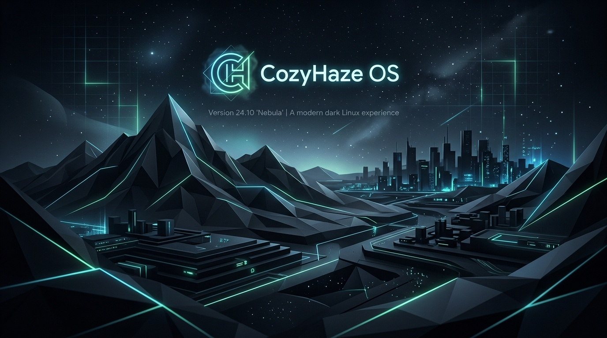

# CozyHaze OS Ultimate 🌫️
**Die maßgeschneiderte, hochoptimierte All-in-One Linux-Workstation für das Apple MacBook Pro 15" (2011 – Modell MacBookPro8,2)**



---

## 🌟 Über CozyHaze OS Ultimate

**CozyHaze OS Ultimate** ist eine vollständige, installationsfertige All-in-One-Linux-Distribution auf Debian-Basis (Debian 13 Trixie) mit Xfce, die speziell für das **Apple MacBook Pro 15 Zoll aus dem Jahr 2011 (`MacBookPro8,2`)** entwickelt und optimiert wurde.

Dieses legendäre Unibody-MacBook leidet nach einigen Betriebsjahren fast ausnahmslos unter dem bekannten **Radeongate-Hardwaredefekt**: Die dedizierte AMD Radeon Grafikkarte versagt thermisch bedingt und führt zu Dauerschleifen mit grauem/schwarzem Bildschirm oder Systemabstürzen.

**CozyHaze OS Ultimate erweckt dieses MacBook als moderne Hochleistungs-Workstation zu neuem Leben:**
- 🛡️ **Hardware-Isolierung**: Schaltet die defekte AMD Radeon GPU über Apple GMUX I/O-Port-Befehle bereits im Bootloader stromlos.
- ⚡ **Intel HD Graphics 3000 Optimierung**: Konfiguriert den nativen Intel `i915`-Treiber mit Dual-Channel LVDS für maximale Bildschärfe und flüssige Wiedergabe.
- 🏛️ **Zwei-Ebenen-Softwarearchitektur**: 
  - **Ultimate Core**: 291 kuratierte Pakete direkt in der ISO enthalten – 100 % offline nutzbar.
  - **Ultimate Extras**: Zusätzliche spezialisierte Software über das eigene Software Center mit 1 Klick installierbar.
- 🔒 **Sicherheit ab Werk**: UFW-Firewall standardmäßig aktiv, AppArmor aktiv, keine unnötig offenen Ports (SSH-Server standardmäßig inaktiv).
- 🎨 **Modernes Windows-11/macOS-inspiriertes Design**: Schlanke Xfce-Oberfläche im "Dark Neon"-Stil (Anthrazit, Slate, Neon-Cyan & Mintgrün) – extrem reaktionsschnell selbst bei älteren GPUs.
- 🛠️ **Fünf eigene GTK3-Systemzentren**: Volle Kontrolle über Softwareprofile, KI-Assistenten, Automatisierung, Webprojekte und Hardware.

---

## 💻 Zielhardware-Spezifikation (MacBookPro8,2)

| Komponente | Spezifikation | CozyHaze OS Treiber / Status |
| :--- | :--- | :--- |
| **Modell** | Apple MacBook Pro 15" (Early/Late 2011) | DMI-Erkennung: `MacBookPro8,2` (A1286) |
| **Prozessor** | Intel Core i7 / i5 (Sandy Bridge, 2. Gen) | Optimiert mit Intel P-State & TLP Energiesteuerung (AVX1) |
| **Arbeitsspeicher** | 16 GB DDR3 RAM (1333 MHz) | ZRAM Swap mit zstd-Kompression für flüssiges Multitasking |
| **Festplatte** | 512 GB SATA-SSD | SSD TRIM (`fstrim.timer`) & optimierte I/O-Scheduler |
| **Primäre GPU** | **Intel HD Graphics 3000** | Mesa 3D (OpenGL 3.3), `i915.lvds_channel_mode=2` |
| **Defekte dGPU**| **AMD Radeon HD 6490M / 6750M / 6770M** | **Vollständig stromlos geschaltet** (`outb 0x750 0`, Blacklist) |
| **Firmware** | Apple EFI64 | EFI-Variable `gpu-power-prefs` Fixierung (0x01) |
| **WLAN** | Broadcom BCM4331 (802.11a/b/g/n) | `broadcom-sta-dkms` / `firmware-brcm80211` |
| **Trackpad** | Apple Glas-Multitouch (bcm5974) | `libinput` mit Natural Scrolling & Tap-to-Click |
| **Audio** | Cirrus Logic CS4206 Audio-Codec | PipeWire + WirePlumber (Knackfreies Umschalten) |
| **Tastatur** | Apple Tastatur mit Hintergrundbeleuchtung | `hid_apple` (F1-F12 primär, PC-Tastenlayout) |

---

## 🚀 Die 16 Vollwertigen Aufgabenbereiche

CozyHaze OS Ultimate deckt 16 zentrale Anwendungsbereiche nahtlos ab:

1. **Programmierung**: GCC, G++, Clang, Make, CMake, GDB, OpenJDK, Rust (`cargo`), Go, Python 3, Node.js, PHP, Lua, Neovim, Meld, Geany, Git GUI.
2. **Webentwicklung**: **CozyHaze Web Starter** für React, Vue, Next.js, Django, FastAPI, Flask, Laravel, Express.
3. **Cybersecurity & Ethical Hacking**: Nmap, Wireshark & tshark (ohne Root), tcpdump, Lynis, ClamAV, rkhunter, TestDisk, PhotoRec, Foremost, John the Ripper, Hydra, Nikto, KeePassXC.
4. **Netzwerk & Homelab**: Remmina (RDP/VNC/SSH), OpenSSH Client, WireGuard, OpenVPN, SMB/CIFS, NFS, FileZilla.
5. **Office & Produktivität**: LibreOffice Suite (Writer, Calc, Impress, Draw), PDFArranger, Simple-Scan, Tesseract OCR (Deutsch & Englisch).
6. **Internet & Browser**: Firefox ESR (datenschutzoptimiert), Chromium, Transmission BitTorrent.
7. **Kommunikation**: Thunderbird (E-Mail/PGP), Jitsi Meet (WebRTC), Discord/Element Vorbereitung, PipeWire Headset-Unterstützung.
8. **Künstliche Intelligenz**: **CozyHaze AI Center** (ChatGPT, Claude, Gemini, Copilot), LAN Homelab LLM Server Modus, sichere Secret-Verwaltung (`0600` Dateirechte).
9. **Automatisierung**: **CozyHaze Automation Center**, Playwright Runner, systemd Timer- & Cron-Manager, Log-Inspektor.
10. **Datenbanken & Datenanalyse**: SQLite3, PostgreSQL Client, MySQL/MariaDB Client, Redis CLI, Pandas, NumPy, JupyterLab.
11. **Virtualisierung & Container**: Podman (rootless), Docker CLI & Compose (Daemon standardmäßig inaktiv).
12. **Grafikdesign**: GIMP, Inkscape, ImageMagick, Flameshot, Krita Vorbereitung.
13. **Musikproduktion**: PipeWire Low-Latency, Audacity, LMMS, Ardour DAW, ALSA MIDI Sequencer.
14. **Multimedia**: VLC Media Player, FFmpeg, HandBrake.
15. **Gaming & Emulation**: RetroArch Multi-Emulator, Gamepad-Unterstützung (`jstest-gtk`, SDL2).
16. **Datenschutz & Sicherheit**: UFW Firewall ab Werk aktiv, AppArmor aktiv, keine offenen Netzwerkports.

Für Details zu jedem Bereich siehe [docs/ULTIMATE_ECOSYSTEM_GUIDE.md](docs/ULTIMATE_ECOSYSTEM_GUIDE.md).

---

## 🛠️ Die Fünf CozyHaze System-Applikationen

Alle Werkzeuge sind in modernem Python 3 mit GTK 3 geschrieben und bieten ein konsistentes Dark-Theme:

### 1. CozyHaze Control Center (`cozyhaze-control-center`)
Zentrale System- und Hardwareverwaltung:
- Dashboard für CPU-, RAM- und SSD-Auslastung sowie AppleSMC-Sensoren.
- UFW-Firewall Umschalter & Echtzeit-Inspektor offener Netzwerkports (`ss -tulpn`).
- Intel vs. AMD GPU-Betriebsstatus.
- Diensteverwaltung (Docker, SSH, Bluetooth) und SSD-TRIM.

### 2. CozyHaze Software Center (`cozyhaze-software-center`)
Grafischer Paket- und Profilmanager:
- **8 Vordefinierte Profile**: Ultimate Complete, Developer, Cybersecurity, AI & Automation, Office & Business, Multimedia Creator, Server Admin, Minimal Performance.
- **10 Ultimate Extras** mit integrierter Hardware-Kompatibilitätsprüfung.
- System-Aktualisierungsassistent.

### 3. CozyHaze AI Center (`cozyhaze-ai-center`)
Zentrale Drehscheibe für KI-Assistenten:
- Schnellzugriff auf ChatGPT, Claude, Gemini und GitHub Copilot.
- **LAN Homelab LLM Server Integration**: Verbindet CozyHaze mit rechenstarken KI-Servern im Heimnetzwerk.
- **Sicherer Secret Store**: API-Schlüssel werden in `~/.config/cozyhaze/ai_keys.json` mit strikten `0600`-Dateirechten geschützt.

### 4. CozyHaze Automation Center (`cozyhaze-automation-center`)
Automatisierungs- und Task-Manager:
- Übersicht aller systemd Timer und Cron-Jobs.
- Playwright- und Python-Skript-Starter mit Log-Anzeige.

### 5. CozyHaze Web Starter (`cozyhaze-web-starter`)
1-Klick-Projektstarter für Web-Entwickler:
- Generiert sofort lauffähige Vorlagen für React, Vue, Next.js, Django, FastAPI, Flask, Laravel und Express.

---

## 🔧 Eigene GPU-Reparatur- und Diagnosewerkzeuge

- **`cozyhaze-gpu-repair`**: Interaktives Terminal-Werkzeug zur sicheren Verankerung der EFI-Variable `gpu-power-prefs` (0x01 = Intel HD 3000 erzwungen) im Apple NVRAM mit automatischem Backup.
- **`cozyhaze-gpu-diag`**: Detaillierte Diagnose von GMUX I/O-Registern, PCI-Bridges und Treiberstatus.

---

## 💿 ISO Erstellung (Reproduzierbares Buildsystem)

Das Buildsystem basiert auf Debian `live-build` und kann wahlweise nativ unter Debian/Ubuntu oder plattformunabhängig per Docker ausgeführt werden:

### Option A: Mit Docker (Empfohlen)
```bash
# Im Projektstammverzeichnis ausführen:
docker build -t cozyhaze-builder -f build/Dockerfile.builder .
docker run --privileged -v $(pwd):/workspace cozyhaze-builder /workspace/build/build-iso.sh
```

### Option B: Nativ auf Debian 13 / Ubuntu
```bash
# Abhängigkeiten installieren:
sudo ./build/setup-build-env.sh

# Live-Build Umgebung vorbereiten und ISO bauen:
./build/build-iso.sh
```

Die fertige Hybrid-ISO wird mit SHA256-Prüfsumme in `output/` abgelegt:
- `output/cozyhaze-os-ultimate-macbook2011-amd64.iso`
- `output/cozyhaze-os-ultimate-macbook2011-amd64.iso.sha256`

---

## 🧪 Qualitätssicherung & Testberichte

Das Projekt beinhaltet eine umfassende automatisierte Test-Suite:
```bash
py tests/run_all_tests.py
```
- **53 von 53 automatisierten Tests bestanden (100 % Erfolgsquote)**.
- Detaillierter Bericht: [docs/TEST_AND_VALIDATION_REPORT.md](docs/TEST_AND_VALIDATION_REPORT.md).
- Hardware-Kompatibilitätsmatrix: [docs/HARDWARE_COMPATIBILITY_MATRIX.md](docs/HARDWARE_COMPATIBILITY_MATRIX.md).
- Installationsanleitung: [docs/INSTALLATION_GUIDE.md](docs/INSTALLATION_GUIDE.md).
