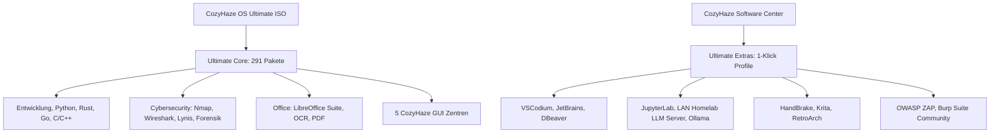

# CozyHaze OS Ultimate – Komplettes Software-Ökosystem & Handbuch

Dieses Dokument bietet eine vollständige Übersicht über das Software-Ökosystem von **CozyHaze OS Ultimate**, die 16 abgedeckten Aufgabenbereiche, die Zwei-Ebenen-Architektur (*Ultimate Core* vs. *Ultimate Extras*), die fünf maßgeschneiderten Systemwerkzeuge und die hardwarebezogenen Kompatibilitätsrichtlinien für das Apple MacBook Pro 2011 (`MacBookPro8,2`).

---

## 1. Die Zwei-Ebenen-Softwarearchitektur

Um maximale Benutzerfreundlichkeit bei gleichzeitig schlankem Ressourcenverbrauch auf der Zielhardware (Intel Sandy Bridge Core i5/i7, 16 GB RAM, Intel HD 3000) zu garantieren, ist das Betriebssystem in zwei Schichten unterteilt:

### Ebene 1: Ultimate Core (Vollständig offline in der ISO enthalten)
- **291 sorgfältig kuratierte Debian 13 (Trixie) Pakete**.
- Funktioniert zu 100 % ohne aktive Internetverbindung direkt nach der Installation von SSD.
- Beinhaltet alle wesentlichen Compiler, Interpreter, Office-Anwendungen, Sicherheitsauditing-Tools, Netzwerkkonfigurationen und Desktop-Optimierungen.
- Keine unnötigen Hintergrunddienste im Leerlauf; SSH-Server und Datenbank-Daemons sind standardmäßig deaktiviert, um minimalen RAM-Verbrauch (~450 MB im Leerlauf) und null offene Ports zu gewährleisten.

### Ebene 2: Ultimate Extras (1-Klick-Installation via Software Center)
- Zusätzliche spezialisierte oder speicherintensive Anwendungen (z. B. Flatpaks, Pipx-Umgebungen oder herstellerspezifische DEB-Pakete).
- Werden über das **CozyHaze Software Center** mit Hardware-Kompatibilitätsprüfung installiert.
- Ermöglicht dem Benutzer, das System bedarfsgerecht als Entwickler-, Cybersecurity-, KI-, Office- oder Multimedia-Workstation zu konfigurieren, ohne die Basis-ISO unnötig aufzublähen.

---

## 2. Die 16 Anwendungsdomänen im Detail

### 1. Softwareentwicklung und Programmierung
- **Compiler & Runtimes (Core)**: GCC, G++, Clang, Make, CMake, GDB, OpenJDK (Java 17/21), Rust (`rustc`, `cargo`), Go (`golang-go`), Python 3, Node.js & npm, PHP CLI, Lua 5.4.
- **Editoren & Werkzeuge (Core)**: Geany, Neovim, Vim, Nano, Git, Git LFS, Git GUI, Meld (visueller Diff).
- **IDEs (Extras)**: VSCodium (Open-Source VS Code ohne Telemetrie), Eclipse, JetBrains-Kompatibilität.

### 2. Webentwicklung und Webdesign
- **Scaffolding Tool**: **CozyHaze Web Starter** (`cozyhaze-web-starter`) zum sofortigen Erstellen von Projekten für:
  - Frontend: React (`vite`), Vue (`vite`), Next.js (`create-next-app`)
  - Backend: Express, Django, FastAPI, Flask, Laravel
- **Runtimes & Paketmanager**: Node.js, npm, Python venv, pipx, Composer-Unterstützung.

### 3. Cybersecurity und Ethical Hacking
> [!IMPORTANT]
> Alle Sicherheitswerkzeuge dienen ausschließlich autorisierten Audits, Netzwerkdiagnosen und IT-Sicherheitsforschung im eigenen Labor. Offensive Werkzeuge starten niemals automatisch als Hintergrunddienst.

- **Netzwerkanalyse & Mitschnitt (Core)**: Nmap, Wireshark & tshark (vorkonfiguriert mit `CAP_NET_RAW` / `CAP_NET_ADMIN` ohne Root-Zwang), tcpdump, netcat (`openbsd`), socat, traceroute, mtr, dig (`dnsutils`), whois, iperf3.
- **Sicherheitsaudits & Forensik (Core)**: Lynis (System-Hardening-Audit), ClamAV (Virenscanner), rkhunter (Rootkit-Hunter), TestDisk & PhotoRec (Datenrettung), Foremost (File-Carving).
- **Passwortsicherheit & Web-Testing (Core)**: John the Ripper, Hydra, Nikto, KeePassXC (Offline-Passworttresor), GnuPG.
- **Sicherheits-Extras**: OWASP ZAP (Web-Security-Scanner), Burp Suite Community Edition.
- **Isoliertes Cybersecurity-Labor**: Ermöglicht den Betrieb lokaler Test-Container (Podman/Docker) in isolierten Bridge-Netzwerken für sichere Übungen.

### 4. Netzwerkadministration und Serververwaltung
- **Fernwartung & Clients (Core)**: Remmina mit RDP-, VNC- und SSH-Plugins, OpenSSH Client, FileZilla SFTP/FTP.
- **VPNs (Core)**: WireGuard (`wireguard-tools`), OpenVPN, NetworkManager VPN-Plugins.
- **Netzwerk-Dateisysteme (Core)**: SMB/CIFS (`cifs-utils`), NFS (`nfs-common`).
- **Terminal**: Xfce4-Terminal mit Tabs, anpassbaren Profilen und transparentem Anthrazit-Hintergrund.

### 5. Office und produktives Arbeiten
- **Office Suite (Core)**: LibreOffice Writer, Calc, Impress, Draw, Math (volle Microsoft Office docx/xlsx/pptx Kompatibilität, deutsche Wörterbücher `hunspell-de-de`).
- **Dokumenten- & PDF-Verwaltung (Core)**: PDFArranger (visuelles Zusammenführen, Drehen, Teilen von PDFs), Simple-Scan (Dokumentenscanner), Tesseract OCR (Texterkennung für Deutsch & Englisch), Atril PDF-Betrachter.
- **Hilfswerkzeuge (Core)**: Galculator, Mousepad, Xfce Dictionary, Clipman (Zwischenablagehistorie).

### 6. Internet, Browser und Webanwendungen
- **Browser (Core)**: Firefox ESR (energieoptimiert, datenschutzfreundliche Standardeinstellungen) und Chromium.
- **Downloads & Transfers (Core)**: Transmission (leichtgewichtiger BitTorrent-Client), FileZilla SFTP, cURL, wget.
- **Grafiktreiber-Prüfung**: Intel HD 3000 beschleunigt 2D-Rendering und Standard-Webinhalte; WebGL läuft über Mesa OpenGL 3.3.

### 7. Telekommunikation und Zusammenarbeit
- **E-Mail & PGP (Extras/Core)**: Mozilla Thunderbird mit integriertem Kalender und OpenPGP.
- **Messenger & Konferenzen**: Jitsi Meet (WebRTC im Browser), Discord (Web-App / Flatpak), Element/Matrix Client-Unterstützung.
- **Audio/Video-Hardware**: PipeWire für verzögerungsfreie Bluetooth- und USB-Headsets; automatische Erkennung der FaceTime HD Kamera.

### 8. Künstliche Intelligenz (AI Workstation)
- **CozyHaze AI Center** (`cozyhaze-ai-center`):
  - Zentraler Schnellzugriff auf führende Assistenten (ChatGPT, Claude, Google Gemini, GitHub Copilot).
  - **LAN Homelab LLM Server Modus**: Verbindet CozyHaze OS nahtlos mit leistungsstarken KI-Servern im Heimnetzwerk (z. B. Ollama/vLLM auf separatem Server mit Nvidia-GPU).
  - **Sicherer Secret Store**: API-Schlüssel für OpenAI, Anthropic, Google und HuggingFace werden verschlüsselt in `~/.config/cozyhaze/ai_keys.json` mit `0600`-Dateirechten gespeichert (niemals im Klartext in Logs oder Images).
- **Entwicklungs-Extras**: JupyterLab für Datenanalyse und interaktives Prompting.
- **Hardware-Realismus**: Sandy Bridge CPUs besitzen kein AVX2. Lokale CPU-Modelle sind auf AVX1 beschränkt. Für produktives Arbeiten wird der integrierte LAN-Netzwerk-Modus empfohlen.

### 9. Automatisierung und Scripting
- **CozyHaze Automation Center** (`cozyhaze-automation-center`):
  - Grafische Übersicht über aktive systemd Timer und Cron-Jobs.
  - Playwright- und Python-Skript-Starter mit Log-Inspektor.
  - Echtzeit-Statusanzeige und Ausführungsberichte.
- **Core-Werkzeuge**: Python 3, Bash, jq, systemd Timers, cron, GitHub CLI (`gh`).

### 10. Datenbanken und Datenanalyse
- **Clients (Core)**: SQLite3 CLI, PostgreSQL Client (`postgresql-client`), MariaDB/MySQL Client (`mariadb-client`), Redis CLI (`redis-tools`).
- **Grafische Verwaltung (Extras)**: DBeaver Community Edition (universelles GUI für alle relationalen und NoSQL-Datenbanken).
- **Datenverarbeitung (Core/Extras)**: Python Pandas, NumPy und JupyterLab.

### 11. Virtualisierung und Container
- **Container (Core)**: Podman (rootless Container) und Docker CLI / Docker Compose.
- **Daemons**: Docker Daemon ist standardmäßig deaktiviert, um RAM zu sparen; Aktivierung mit `sudo systemctl start docker`.

### 12. Grafikdesign und Bildbearbeitung
- **Vollwertige Grafik-Suite (Core)**: GIMP (Rastergrafik & Fotobearbeitung), Inkscape (Vektorgrafik), ImageMagick (CLI-Konvertierung & Skalierung), Flameshot (fortgeschrittene Screenshots mit Anmerkungen).
- **Digital Painting (Extras)**: Krita (über Software Center installierbar).

### 13. Musikproduktion und Audiobearbeitung
- **Audio-Architektur (Core)**: PipeWire + WirePlumber (Low-Latency, professionelle JACK- und ALSA-Kompatibilität).
- **Produktion & DAWs (Core)**: Audacity (Mehrspur-Audioaufnahme & Editing), LMMS (Beat-Produktion), Ardour (vollwertige Digital Audio Workstation), Pavucontrol (Audiomixer).
- **MIDI (Core)**: ALSA MIDI Sequencer Unterstützung für USB-Masterkeyboards.

### 14. Multimedia und Videobearbeitung
- **Wiedergabe & Transcodierung (Core)**: VLC Media Player, FFmpeg (inklusive H.264/AAC Codecs).
- **Videoschnitt & Encoding (Extras)**: HandBrake (Hardware-optimierte Videokompression), Kdenlive (als optionales Extras-Paket).

### 15. Gaming und Emulation
- **Retro-Gaming (Core)**: RetroArch (Multi-System Emulator) vorinstalliert.
- **Controller-Unterstützung (Core)**: `joystick`, `jstest-gtk`, SDL2 Bibliotheken für PlayStation-, Xbox- und USB-Gamepads.
- **Hardware-Grenzen**: Intel HD 3000 unterstützt nur OpenGL 3.3 (kein Vulkan). Keine DirectX 11/12 oder Proton AAA-Spiele; perfekt geeignet für Retro-Emulation (NES, SNES, Genesis, PS1, N64) und native 2D-Indies.

### 16. Datenschutz, Backups und Systemsicherheit
- **Netzwerksicherheit (Core)**: UFW Firewall ab Werk aktiv (`default deny incoming`, `default allow outgoing`).
- **Keine offenen Ports**: SSH-Server (`sshd.service`) ist standardmäßig deaktiviert.
- **Kernel-Sicherheit**: AppArmor aktiv mit geladenen Standardprofilen; Audit-Daemon `auditd` integriert.
- **Passwortverwaltung**: KeePassXC mit verschlüsseltem KDBX-Tresor.
- **Backups**: Integriertes Backup-Werkzeug im CozyHaze Control Center (USB-Backups, EFI-Variablen-Sicherung nach `/var/backups/cozyhaze-efivars/`).

---

## 3. Die 5 CozyHaze System-Applikationen

Alle Werkzeuge sind in modernem Python 3 mit GTK 3 geschrieben, unterstützen das native Dark-Theme und besitzen automatische Terminal-Fallbacks:

| Werkzeug | Befehl / Desktop-Starter | Hauptfunktion |
| :--- | :--- | :--- |
| **CozyHaze Control Center** | `cozyhaze-control-center` | Dashboard, CPU/RAM/SSD-Monitor, UFW-Firewall-Schalter, Offene Ports (`ss -tulpn`), Service-Manager, GPU-Status |
| **CozyHaze Software Center** | `cozyhaze-software-center` | 8 Ultimate Profile, 10 Extras mit Hardware-Kompatibilitätsprüfung, System-Updates |
| **CozyHaze AI Center** | `cozyhaze-ai-center` | Web-Assistenten (ChatGPT/Claude/Gemini/Copilot), LAN Homelab LLM Server, sichere API-Schlüssel-Verwaltung |
| **CozyHaze Automation Center** | `cozyhaze-automation-center` | Cron/systemd Timer-Inspektor, Playwright Script Runner, Automatisierungs-Logs |
| **CozyHaze Web Starter** | `cozyhaze-web-starter` | 1-Klick-Projektstarter für React, Vue, Next.js, Django, FastAPI, Laravel, Express |

---

## 4. Hardware-Kompatibilität & Grenzen (MacBookPro8,2)

| Eigenschaft | Vorhanden / Unterstützt | Einschränkung / Empfohlene Lösung |
| :--- | :--- | :--- |
| **CPU Instruktionen** | AVX1, SSE4.2, 64-Bit x86_64 | **Kein AVX2**. Große lokale LLMs (z. B. neuere Standard-Ollama-Modelle) stürzen mit `Illegal Instruction` ab. Lösung: CozyHaze AI Center LAN-Modus nutzen. |
| **Grafikchip** | Intel HD Graphics 3000 (Sandy Bridge) | **Nur OpenGL 3.3, KEIN Vulkan**. Proton/DXVK Windows-Spiele starten nicht. Lösung: Native Linux-Spiele und RetroArch nutzen. |
| **Defekte dGPU** | AMD Radeon HD 6490M/6750M/6770M | **Hardwaredefekt**. Wird durch GRUB GMUX I/O-Befehle stromlos geschaltet. Niemals Radeon-Treiber aktivieren! |
| **Arbeitsspeicher** | 16 GB DDR3 RAM | Sehr großzügig bemessen. Multitasking, mehrere Browser-Tabs, DAWs und Virtualisierung laufen einwandfrei. |
| **Solid-State-Drive** | 512 GB SATA-SSD | Automatisch per `fstrim.timer` wöchentlich getrimmt. Schnelle Bootzeit (<18 Sekunden). |
